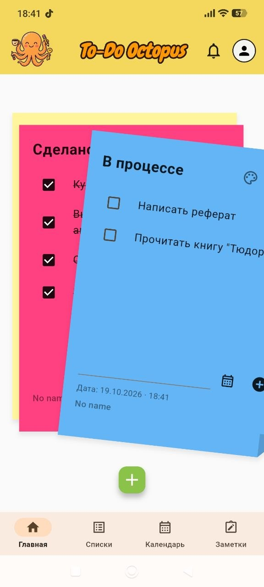
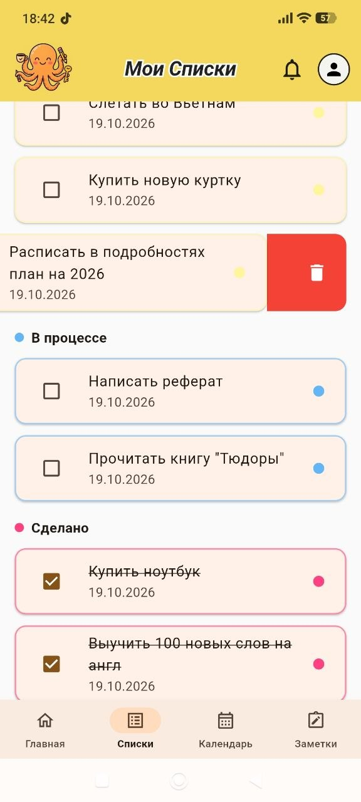
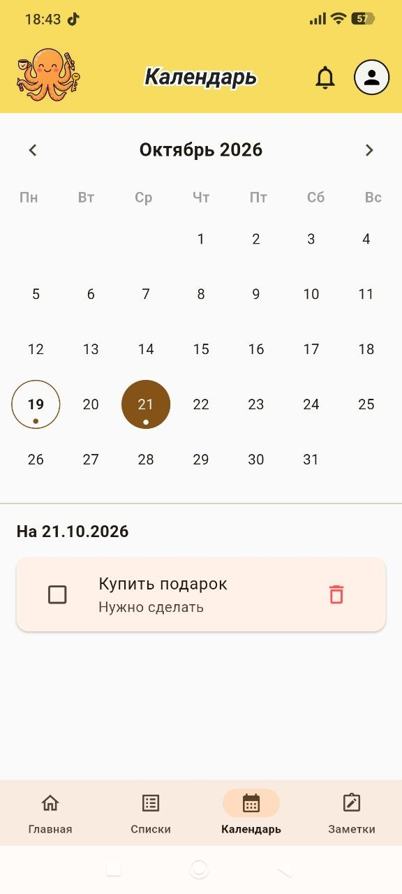
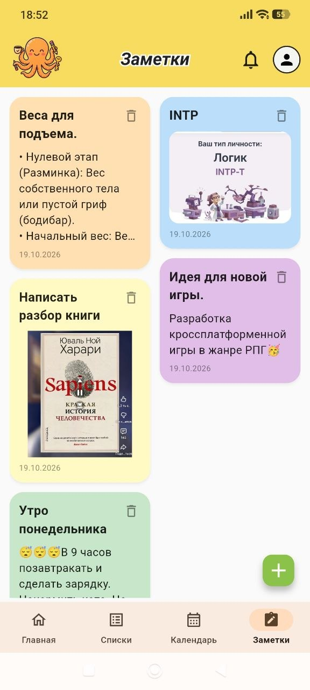

<p align="center">
  
</p>

<h1 align="center">To-Do Octopus</h1>

<p align="center">
  A mobile app for tasks, notes and a calendar, with cloud sync.<br/>
  <a href="README.md">Русская версия</a>
</p>

<p align="center">
  
  
  
  
</p>

## Features

- **Sticky-note cards on the home screen.** Tasks live on colored cards (up to 20), swipe to cycle through them. A completed task flies into the "Done" card and returns to its original card when unchecked.
- **Lists:** one list of all tasks, swipe to delete, optional grouping by card.
- **Calendar:** month grid with markers for days that have tasks or note reminders.
- **Notes:** two-column masonry layout, colors, emoji, an attached image, reminders.
- **Real notifications** at a task deadline or note reminder (exact alarms, time zones, rescheduled on every launch).
- **Overdue tasks:** bell icon with a counter and a bottom sheet.
- **Accounts and sync:** email or Google sign-in, multi-device sync that also works offline.
- **Profile:** name and cropped avatar, dark theme, default colors, account deletion.
- **Android home-screen widgets.**

## Tech stack

Flutter · Dart · Provider · Firebase Auth + Cloud Firestore · Supabase Storage (RLS) · shared_preferences · flutter_local_notifications · image_picker / image_cropper / flutter_image_compress

## Engineering highlights

- **Offline-first sync** with server timestamps and a persisted "last updated on this device" marker, so a stale Firestore offline cache never overwrites fresh local edits.
- **Per-account data isolation:** local data is wiped on sign-out.
- **Image pipeline:** stepwise compression to about 1 MB, a local copy first, then background upload with retry. Each device writes only to its own storage folder.
- **Reliable reminders** that survive reboots and cope with aggressive battery savers.
- **Robust layouts** under large system font sizes.
- **Unit tests** for models and `TodoProvider` logic.

## Getting started

1. Install [Flutter](https://docs.flutter.dev/get-started/install), then:
   ```bash
   git clone https://github.com/YOUR-NAME/to_do.git
   cd to_do
   flutter pub get
   ```
2. **Firebase** (free Spark plan): create a project, enable Email/Password and Google sign-in plus Cloud Firestore, then run `flutterfire configure`. Add your key's SHA-1 for Google sign-in. Firestore rules: [`docs/firestore.rules`](docs/firestore.rules).
3. **Supabase** (free plan): enable *Allow anonymous sign-ins*, run [`docs/supabase_setup.sql`](docs/supabase_setup.sql), then copy `lib/core/config/supabase_config.example.dart` to `supabase_config.dart` and fill in your URL and publishable key.
4. `flutter run`

## Build an APK

```bash
flutter build apk --release
```
Output: `build/app/outputs/flutter-apk/app-release.apk`. Prebuilt versions are on the [Releases](../../releases) page.

## Author

[YOUR NAME](https://github.com/YOUR-NAME)
