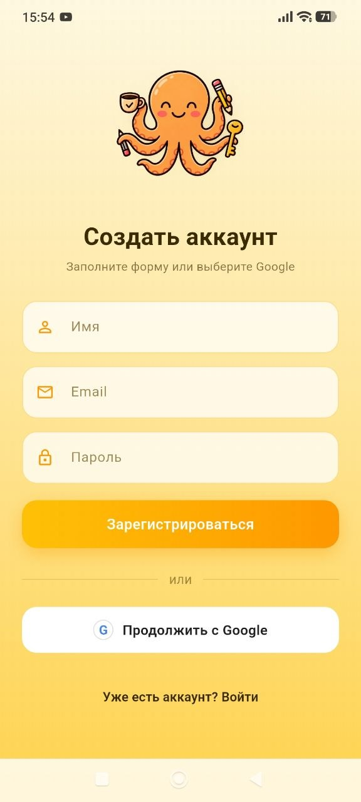
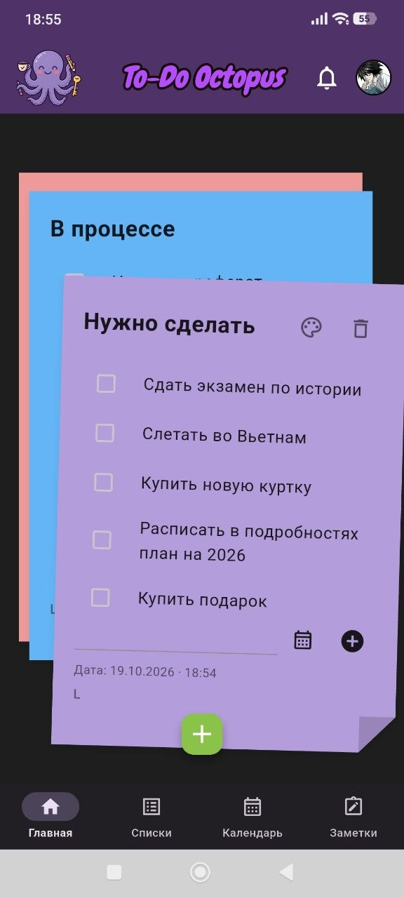
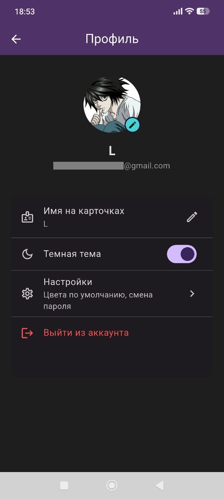
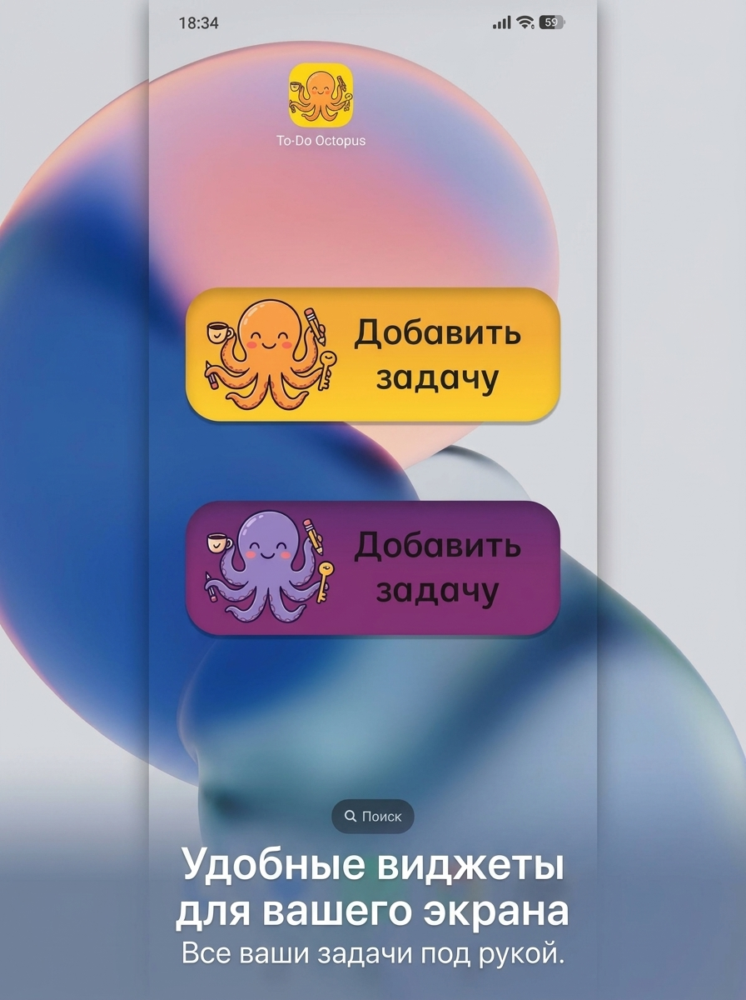

<p align="center">
  
</p>

<h1 align="center">To-Do Octopus</h1>

<p align="center">
  Мобильное приложение для задач, заметок и календаря с облачной синхронизацией.<br/>
  <a href="README.en.md">English version</a>
</p>

<p align="center">
  
  
  
  
  
</p>


<!-- СКРИНШОТЫ: положи файлы в docs/screenshots/ и поправь имена при необходимости -->
<p align="center">
  
  
  
  
  
</p>
<p align="center">
  
  
  

</p>

## Возможности

- **Карточки-«стикеры» на главной** — задачи раскладываются по цветным карточкам-отсекам (до 20), карточки перелистываются свайпом. Выполненная задача сама «улетает» в карточку «Сделано», а при снятии галочки возвращается обратно.
- **Списки** — сквозной список всех задач, удаление свайпом, режим группировки по карточкам.
- **Календарь** — месячная сетка с отметками дней, где есть задачи или напоминания по заметкам.
- **Заметки** — мозаика в две колонки, цвета, эмодзи, картинка к заметке, напоминание.
- **Настоящие уведомления** — по дедлайну задачи и по напоминанию заметки (точные будильники, часовые пояса, перепланирование после перезагрузки телефона).
- **Просроченные задачи** — колокольчик со счётчиком и шторка со списком.
- **Аккаунт и синхронизация** — вход по email или через Google, данные синхронизируются между устройствами и работают офлайн.
- **Профиль** — имя и аватар с кадрированием, тёмная тема, цвета по умолчанию, смена пароля, удаление аккаунта.
- **Виджеты Android** на рабочий стол.

## Виджеты

Два виджета для рабочего стола Android — светлый и тёмный. Нажатие на виджет открывает приложение.

<p align="center">
  
</p>

## Технологии

| Область | Что используется |
|---|---|
| Фреймворк | Flutter, Dart |
| Состояние | Provider (`ChangeNotifier`) |
| Вход | Firebase Authentication (email + Google) |
| Синхронизация | Cloud Firestore |
| Картинки | Supabase Storage (с политиками доступа RLS) |
| Локальное хранилище | shared_preferences |
| Уведомления | flutter_local_notifications, timezone |
| Картинки на устройстве | image_picker, image_cropper, flutter_image_compress |

## Архитектура

```
lib/
├── core/
│   ├── models/        # TaskModel, NoteModel, TodoCategoryModel (JSON)
│   ├── providers/     # TodoProvider, NotesProvider, UserProfileProvider, SettingsProvider
│   ├── services/      # SyncManager, уведомления, сжатие и загрузка картинок
│   ├── theme/         # светлая/тёмная тема
│   └── utils/
└── features/          # экраны: navigation, todo_lists, task_list, calendar, notes, profile
```

Единый источник правды по задачам — `TodoProvider`: Главная, Списки и Календарь читают из него, поэтому изменение видно везде сразу.

## Инженерные решения

- **Офлайн-first синхронизация.** Данные сохраняются локально после каждого изменения, а в облако уходят с задержкой (debounce). Время изменения ставит сервер, а метка «когда обновлялись данные на этом телефоне» хранится на диске: устаревший офлайн-кэш Firestore не затирает свежие локальные правки.
- **Изоляция данных между аккаунтами.** При выходе локальные задачи, заметки, профиль и настройки сбрасываются, чтобы следующий человек на том же телефоне не увидел чужое.
- **Конвейер картинок.** Фото сжимается до ~1 МБ (ступенчатое сжатие), сохраняется в постоянную папку приложения и в фоне загружается в Supabase Storage; при ошибке загрузка повторяется. Каждый телефон пишет только в свою папку (анонимный вход Supabase + RLS).
- **Надёжные напоминания.** Уведомления перепланируются при каждом запуске, учитывают часовой пояс, а для телефонов с агрессивной экономией батареи (в том числе MIUI) приложение подсказывает нужные настройки.
- **Устойчивая вёрстка.** Верхняя и нижняя панели не меняются при увеличении системного шрифта, а диалоги выбора даты ограничивают масштаб, чтобы цифры не слипались.
- **Тесты** логики моделей и `TodoProvider` (`flutter test`).

## Запуск

1. Установи [Flutter](https://docs.flutter.dev/get-started/install) и клонируй репозиторий:
   ```bash
   git clone https://github.com/ВАШ-НИК/to_do.git
   cd to_do
   flutter pub get
   ```
2. **Firebase** (бесплатный тариф Spark): создай проект, включи Authentication (Email/Password и Google) и Cloud Firestore, затем выполни
   ```bash
   dart pub global activate flutterfire_cli
   flutterfire configure
   ```
   Это создаст `lib/firebase_options.dart` и `android/app/google-services.json`. Для входа через Google добавь SHA-1 своего ключа в настройках Android-приложения Firebase. Правила Firestore лежат в [`docs/firestore.rules`](docs/firestore.rules).
3. **Supabase** (бесплатный тариф): создай проект, включи **Allow anonymous sign-ins** (Authentication → Sign In / Providers) и выполни [`docs/supabase_setup.sql`](docs/supabase_setup.sql) в SQL Editor. Скопируй `lib/core/config/supabase_config.example.dart` в `supabase_config.dart` и впиши URL и publishable key.
4. Запусти:
   ```bash
   flutter run
   ```

## Сборка APK

```bash
flutter build apk --release
```
Готовый файл: `build/app/outputs/flutter-apk/To-Do_Octopus_app-arm64-v8a-release.apk`. Скачать собранную версию можно в разделе [Releases](../../releases).

## Планы

- [ ] Публикация в Google Play
- [ ] Повторяющиеся задачи
- [ ] Поиск по задачам и заметкам
- [ ] Версия для iOS

## Автор

[Veronica](https://github.com/buttedark-cloud) · [почта: veronikamalin2000@gmail.com LinkedIn: https://www.linkedin.com/in/veronikamalinovskaya]
